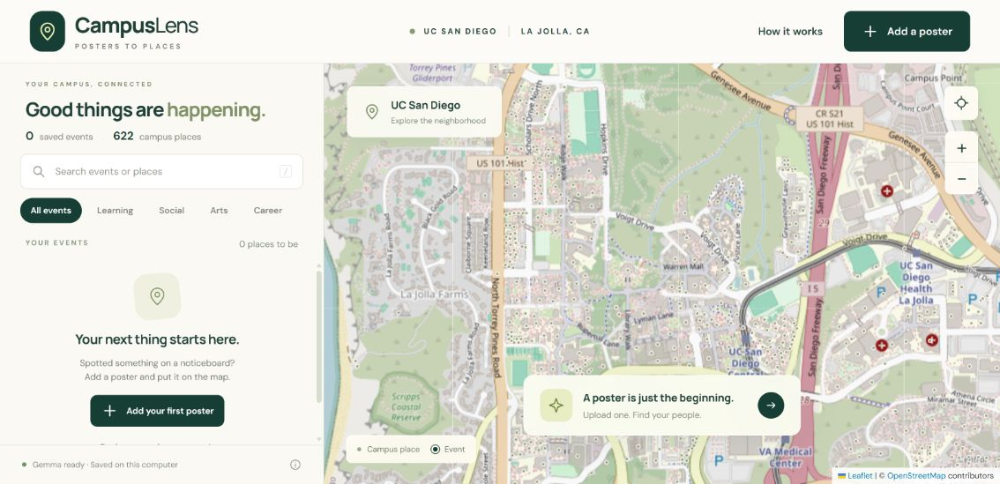

# CampusLens｜把校园海报变成地图上的活动

看到一张活动海报，却不清楚什么时候开始、在哪里集合？CampusLens 可以读取 JPG/PNG 海报中的活动信息，让你核对内容、选择校园建筑，再把活动放到 UC San Diego 地图上。

**上传海报 → 核对信息 → 确认地点 → 保存到地图**

[项目仓库](https://github.com/Wenbo-Bob-Li/campuslens) · [地点数据来源](docs/venue-sources.md)



## 你可以用它做什么

- **读取活动海报**：通过 Gemma 4 提取名称、日期、时间、地点、房间、主办方和活动介绍，并在保存前修改。
- **找到校园建筑**：搜索 622 个校园地点及 2,086 个名称与别名，也可按地址查找。
- **手动指定地点**：没有合适的建筑时，在校园地图上选择集合点。
- **浏览已添加的活动**：按关键词搜索、按类别筛选，点击地图标记查看详情和海报。
- **保留自己的活动记录**：活动和图片保存在本机，关闭后再次启动仍可查看。

当前版本需要在自己的电脑上启动，通过浏览器使用。地图展示你添加的活动；首次使用时，可以先查看虚构样例，或添加第一张海报。

## 安装与启动

需要 **Python 3.11 或更高版本**、浏览器，以及可访问地图底图和 Google 模型服务的网络。自动识别还需要你自己的 Gemini API 密钥；暂时没有密钥时，可以先探索样例或手动录入。

### 1. 下载项目

在 [GitHub 仓库](https://github.com/Wenbo-Bob-Li/campuslens) 点击 **Code → Download ZIP**，解压到自己的电脑。在包含 `app.py` 和 `requirements.txt` 的文件夹中打开终端。

### 2. 安装依赖并启动

**Windows（PowerShell）：**

```powershell
python -m venv .venv
.\.venv\Scripts\python.exe -m pip install -r requirements.txt
.\.venv\Scripts\python.exe app.py
```

**macOS / Linux：**

```bash
python3 -m venv .venv
.venv/bin/python -m pip install -r requirements.txt
.venv/bin/python app.py
```

看到启动地址后，用浏览器打开 **<http://127.0.0.1:8000>**。使用期间保持终端运行；结束时在终端按 `Ctrl+C`。

依赖只需安装一次。下次使用时，进入同一个项目文件夹，运行上述最后一条启动命令即可。

### 3. 开启海报自动识别

1. 打开 [Google AI Studio](https://aistudio.google.com/app/apikey)，创建自己的 Gemini API 密钥。
2. 在项目文件夹中，将 `.env.example` 复制为 `.env`。如果已有 `.env`，直接编辑，不要覆盖原配置。
3. 用文本编辑器填写 `.env`，把下面的占位内容替换成自己的密钥：

```dotenv
GEMINI_API_KEY=your_api_key_here
GEMMA_MODEL=gemma-4-26b-a4b-it
```

4. 保存文件，在应用中点击 **How it works → Refresh status**。显示 **Gemma ready** 后，即可尝试识别海报。

应用会重新读取本机配置，无需为了修改密钥而重启。默认模型为 `gemma-4-26b-a4b-it`；调用需要你的账号具有对应模型的访问权限。服务可用性与配额请查看 [Google 官方说明](https://ai.google.dev/gemma/docs/core/gemma_on_gemini_api)。

`.env` 是本机私有配置，不要上传到 GitHub，也不要把密钥填写到网页代码中。

## 添加一场活动

### 上传与识别

1. 点击 **Add a poster**。
2. 拖入或选择一张 JPG、JPEG 或 PNG 海报，单张不超过 **10 MB**。尽量使用文字清晰、完整且方向正确的静态图片。
3. 查看预览，点击 **Analyze poster**，等待识别完成。

没有海报时，可点击 **Use a sample poster**；想自行填写时，点击 **Enter details manually**。

### 核对信息与地点

核对活动名称、日期、时间和主办方，并按海报原文修正。若海报只写了星期、未注明年份或时区，应保留这些不确定信息。

在 **Find a campus building** 中输入楼名、简称或地址，然后在 **Campus building** 下拉框中选择建筑。例如：

| 输入名称或简称 | 对应建筑 |
| --- | --- |
| `CENTR` | Center Hall |
| `WLH` | Warren Lecture Hall |
| `CSE` | Computer Science and Engineering Building |
| `DIB` | Design and Innovation Building |
| `Geisel` | Geisel Library |

房间号或集合位置填写在 **Room or meeting point**。如果地点不在目录中，在建筑下拉框选择 **Choose a point on the map…**，再点击 **Pick on map** 选择位置，也可以填写校园范围内的经纬度。

如果使用的是虚构海报，请勾选 **This is a sample or fictional event**。最后确认信息和地点，勾选确认框，点击 **Add event to map**。

### 在地图上查看

保存后，地图会定位到该活动。点击活动卡片或地图标记，可以查看时间、建筑、房间、介绍和海报；若填写了有效的活动链接，也可从详情中打开。

左侧搜索框用于查找已添加的活动，类别按钮用于筛选。虚构样例只出现在样例视图中；首次使用可点击 **Explore sample events** 进入，点击 **Exit** 返回真实活动视图。

## 地点覆盖与定位精度

内置目录覆盖 UC San Diego 中央校园、住宿学院、Scripps 海岸设施、东校区及部分医疗、体育和配套建筑，主要采用大学官方公开 GIS 数据。完整来源见 [地点说明](docs/venue-sources.md)。

地图标记表示**建筑或场地区域**。房间、精确入口和具体集合点需要结合活动说明确认。目录中收录某座建筑，不代表该建筑对公众开放或允许举办活动；请以主办方的信息为准。

## 数据与隐私

- 点击 **Analyze poster** 时，海报图片会发送给 Google 的模型 API 进行识别；请确认图片内容适合发送给该服务。
- API 密钥由本机后端读取，保存在自己的 `.env` 中。
- 保存的活动与图片位于项目的 `runtime/` 文件夹。要保留记录，请在移动或重新下载项目时一并备份该文件夹；备份可能包含私人图片，应自行妥善保管。
- 当前版本的记录保存在运行服务的电脑上，不会自动同步到其他设备，也不会因保存到地图而公开发布。

## 常见问题

**页面打不开怎么办？**

确认终端中的服务仍在运行，并使用终端显示的地址打开页面。不要直接双击 `static/index.html`。

**提示端口 8000 已被占用怎么办？**

启动时更换端口，例如 Windows 下运行：

```powershell
.\.venv\Scripts\python.exe app.py --port 8001
```

然后打开 <http://127.0.0.1:8001>。macOS / Linux 使用 `.venv/bin/python app.py --port 8001`。

**已经填写密钥，但仍无法识别怎么办？**

确认文件名是 `.env`，而不是 `.env.txt`，且位于 `app.py` 所在目录。保存后点击 **How it works → Refresh status**。若提示权限、配额或网络错误，请按页面信息检查 Google 账号与网络；也可以先手动录入活动。

**地图空白或底图加载失败怎么办？**

检查网络是否可以访问 OpenStreetMap 底图。底图加载失败时，仍可查看活动列表和录入信息；使用已知建筑或填写坐标完成地点确认。

**找不到建筑，或者出现多个候选地点怎么办？**

尝试完整楼名、其他简称或地址，并核对下拉框中的建筑。多个候选需要自行确认；仍找不到时，使用手动地图落点。

**为什么刚保存的活动没有出现在真实活动列表里？**

如果勾选了虚构样例选项，该活动会保存在样例视图中。确认当前所在视图，并清除可能隐藏活动的搜索条件或类别筛选。

## 许可与更多信息

CampusLens 的原创代码、文档和自带虚构样例采用 [MIT License](LICENSE)。模型与 API、地图、校园数据及用户上传图片遵循各自的许可或使用条款。

- [Gemma 模型与 API 说明](https://ai.google.dev/gemma/docs/core/gemma_on_gemini_api)
- [Leaflet 许可](static/vendor/leaflet-LICENSE.txt)
- [OpenStreetMap 数据与署名](https://www.openstreetmap.org/copyright)
- [校园地点来源](docs/venue-sources.md)
- [项目验证记录](docs/verification.md)

遇到问题时，可以在 [GitHub Issues](https://github.com/Wenbo-Bob-Li/campuslens/issues) 描述操作步骤和页面提示；请隐去 API 密钥及海报中的私人信息。
